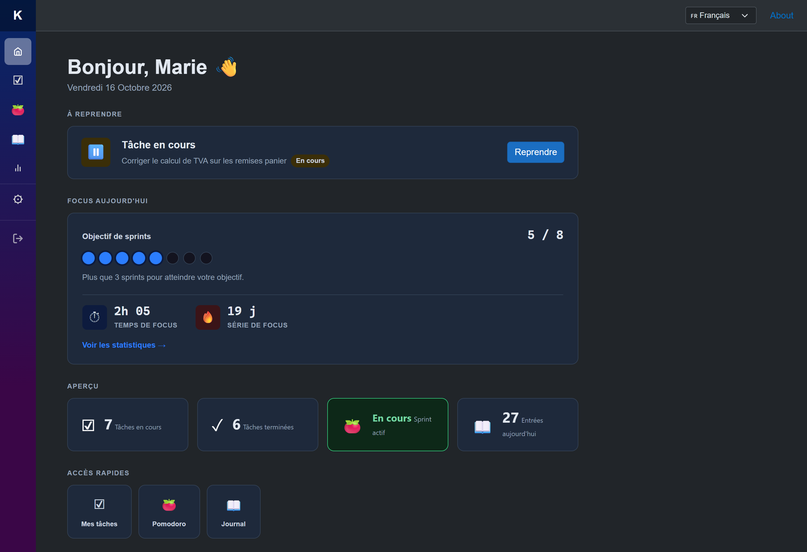

# 🚀 KairuFocus

> Application de gestion d'activité quotidienne pour développeurs.

KairuFocus centralise en un seul endroit tout ce dont un développeur a besoin pour rester focus et organisé : todo list de micro-tâches, journal de bord, sessions Pomodoro, profil de focus, XP et concentration en groupe avec la communauté, et pilotage des tâches par une IA via MCP.



---

## ✨ Fonctionnalités

| Module | Description |
|--------|-------------|
| ☑️ **Tasks** | Micro-tâches quotidiennes — ajout, modification, statut, tags, description Markdown |
| 🍅 **Pomodoro** | Sessions de focus (sprint / pause courte / pause longue) et sprint libre à durée variable, objectif quotidien et série |
| 📖 **Journal** | Timeline d'activité quotidienne générée automatiquement + commentaires personnels |
| 📊 **Profil** | Nom de profil, totaux, sprints faits ensemble, heatmap annuelle, et statistiques privées (temps de focus et sprints par semaine / mois, XP totale et de la semaine) |
| 🏆 **Communauté** | Classement (semaine, mois, général) sous nom de profil, sprints ouverts à rejoindre, présence et bilan collectif. Activation par le membre (opt-in), gérée dans les paramètres |
| 🤖 **MCP** | Serveur MCP (`/mcp`) : une IA crée, liste, modifie, complète et supprime les tâches, authentifiée par un token personnel |
| ⚙️ **Settings** | Thème clair/sombre/système, durées et objectif Pomodoro, sonnerie et volume, communauté, token MCP |
| 🔐 **Auth** | Connexion via GitHub OAuth 2.0, JWT HS256, multi-utilisateurs |
| 🎫 **Tickets** | Intégration Jira Cloud — conservée côté serveur, désactivée dans l'interface depuis l'itération #19 |

**XP** : +10 XP par sprint complété d'au moins 5 minutes. Seuls les membres ayant activé la communauté apparaissent, sous un nom de profil ; l'XP gagnée reste visible même sans participer.

---

## 🛠️ Stack technique

- **Runtime** : .NET 10
- **API** : ASP.NET Core Web API
- **Web** : Blazor WebAssembly
- **Mobile/Desktop** : .NET MAUI (Blazor Hybrid) — Windows, Android, iOS, macOS
- **Orchestration** : .NET Aspire 13.6
- **Base de données** : SQL Server (LocalDB en local, Azure SQL en production) + EF Core 10
- **Auth** : GitHub OAuth 2.0 + JWT HS256 (Web), token personnel (MCP)
- **Tests** : xUnit — 804 tests (Domain, Application, Infrastructure, Api)

---

## 🏛️ Architecture

Clean Architecture (Uncle Bob) + DDD, avec CQRS via BrilliantMediator (handlers source-générés).

```
Domain          →  Entités, Value Objects, règles métier
Application     →  Commands / Queries / Handlers (CQRS)
Infrastructure  →  EF Core, SQL Server, Jira API client
Api             →  Controllers ASP.NET Core, Auth JWT, serveur MCP
Web / Maui      →  UI Blazor (WASM + Hybrid)
```

> 📐 **Règle fondamentale** : les dépendances ne pointent que vers l'intérieur. Le Domain ne connaît rien des couches externes.

```
src/
├── KairuFocus.Domain/          # 🧠 Bounded Contexts : Tasks, Pomodoro, Journal, Settings, Identity, Tickets, Gamification, Community
├── KairuFocus.Application/     # ⚡ 42 use cases CQRS
├── KairuFocus.Infrastructure/  # 🗄️ EF Core + migrations + repositories
├── KairuFocus.Api/             # 🌐 REST API + GitHub OAuth + JWT + MCP
├── KairuFocus.Web/             # 💻 Blazor WASM
├── KairuFocus.Maui/            # 📱 .NET MAUI Blazor Hybrid
├── KairuFocus.AppHost/         # 🔭 Aspire orchestration
└── KairuFocus.ServiceDefaults/ # 📊 OpenTelemetry, health checks
tests/
├── KairuFocus.Domain.Tests/
├── KairuFocus.Application.Tests/
├── KairuFocus.Infrastructure.Tests/
└── KairuFocus.Api.Tests/
docs/
└── screenshots/              # 🖼️ Captures de l'application
```

---

## ⚡ Démarrage rapide

### Prérequis

- [.NET 10 SDK](https://dotnet.microsoft.com/download/dotnet/10.0)
- SQL Server LocalDB (instance `(localdb)\mssqllocaldb`, base `kairufocus` : l'API applique les migrations au démarrage)
- Une [GitHub OAuth App](https://github.com/settings/developers) (voir ci-dessous)

### 1️⃣ Configurer GitHub OAuth

Crée une OAuth App sur [github.com/settings/developers](https://github.com/settings/developers) :

| Champ | Valeur |
|-------|--------|
| Homepage URL | `http://localhost:5010` |
| Authorization callback URL | `http://localhost:5205/signin-github` |

Puis renseigne les credentials dans `src/KairuFocus.Api/appsettings.Development.json` :

```json
{
  "GitHub": {
    "ClientId": "<ton-client-id>",
    "ClientSecret": "<ton-client-secret>"
  },
  "WebBaseUrl": "http://localhost:5010",
  "Jwt": {
    "SecretKey": "une-clé-secrète-de-minimum-32-caractères",
    "ExpiryHours": 24
  }
}
```

> ⚠️ Ne jamais committer ce fichier avec de vraies valeurs.

### 2️⃣ Lancer l'application

**Option A — Aspire (recommandé)** : démarre API + Web + dashboard observabilité

```bash
dotnet run --project src/KairuFocus.AppHost/KairuFocus.AppHost.csproj --launch-profile http
```

| Service | URL |
|---------|-----|
| 🔭 Dashboard Aspire | `http://localhost:15100` |
| 💻 Web app | `http://localhost:5010` |
| 🌐 API | `http://localhost:5205` |

**Option B — Séparé**

```bash
# Terminal 1 — API 🌐
dotnet run --project src/KairuFocus.Api/KairuFocus.Api.csproj --launch-profile http

# Terminal 2 — Web 💻
dotnet run --project src/KairuFocus.Web/KairuFocus.Web.csproj --launch-profile http
```

### 3️⃣ Lancer les tests

```bash
dotnet test
```

```
✅ Réussi! — 804 tests, 0 échec
```

> 💡 Avec Aspire, le redémarrage d'une ressource ne recompile pas le projet : après une modification du Web, recompile-le puis redémarre la ressource, ou relance l'AppHost. Une compilation du projet Web pendant que l'AppHost tourne casse l'instance en cours jusqu'à ce redémarrage.

---

## 🎫 Intégration Jira

Le bounded context Tickets (client Jira Cloud) est conservé côté serveur, mais l'intégration est **désactivée dans l'interface** depuis l'itération #19 : plus de page Tickets ni de configuration Jira dans les paramètres.

---

## 📚 Documentation

La spécification (`spec.md` : use cases, diagrammes, ADR), l'état du projet (`project-state.md`) et les plans de fonctionnalités sont tenus dans un dépôt séparé et privé, **kairu-specs**.

---

## 📄 Licence

Usage privé — projet personnel.
